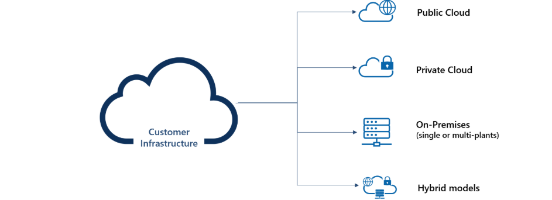
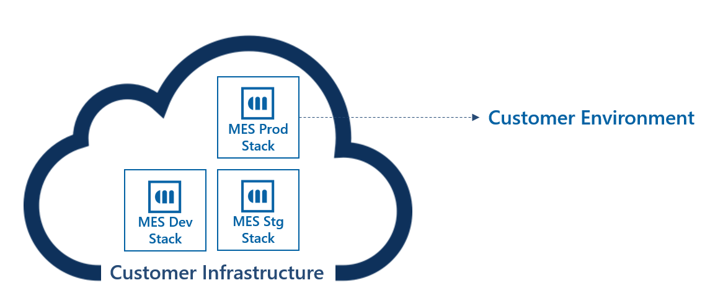
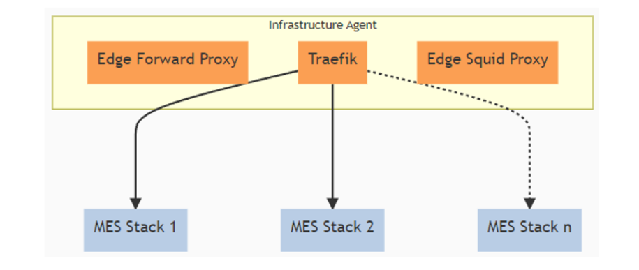
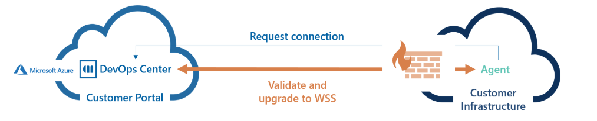
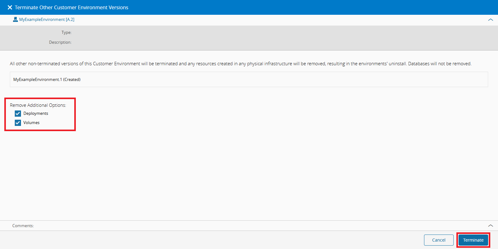
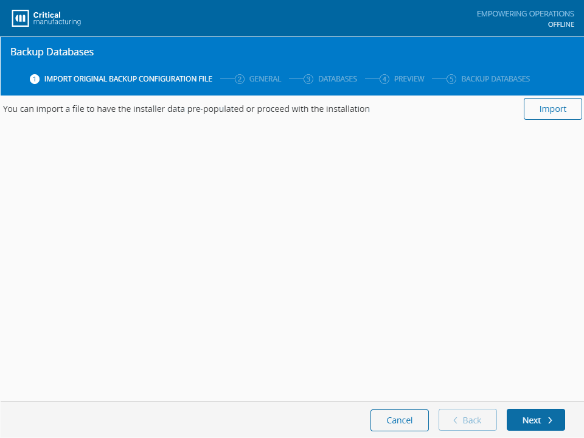

Most broken MES installations come from choosing an installation path that does not fit the situation.

Clean, restore, upgrade, copy and remove look like five variations of "install". Each one keeps and deletes different things, and the install dialog does not list them.

## Before You Start

This post explains the model: what **DevOps Center**, **Customer Infrastructure**, **Infrastructure Agent** and **Customer Environment** are and how they relate, then the five operations with a decision guide, then backups. The [next post](https://j-roque.com/posts/20261120-devops-local-kubernetes/) is the hands-on part, a full install on a local Kubernetes cluster.

The series assumes MES 11.x and 12.x. The documented backup procedures below are written for 12.x and later, and I flag where the 11.2 documentation differs. Reference material is in the [Critical Manufacturing documentation](https://help.criticalmanufacturing.com/). The DevOps Center documentation itself sits behind the Customer Portal login, so where I describe behavior that I could not check on a public page, I say so, and the unverified items are collected in [What I Could Not Verify](#what-i-could-not-verify).

One split runs through the whole post: the **Infrastructure Agent changed shape at 12.0**. Traefik was deprecated in Agent 11.1.0 and is gone from 12.0.0 onward, and the Edge Squid Proxy became optional. Where the two generations differ, I say so.

## The Model: Four Things to Keep Apart

Installing MES by hand means preparing containers, configuration and secrets yourself. DevOps Center generates them. It sits in the Customer Portal, and the [installation guide](https://help.criticalmanufacturing.com/installationguide/installation/) states that installation is carried out directly through it. It produces the YAML files, the agent package and the environment package for you.

The model has four objects:

| Object | What it is | Analogy |
| :-- | :-- | :-- |
| **Customer Infrastructure** | Where environments run: a Kubernetes cluster, or even a work machine | The plot of land |
| **Infrastructure Agent** | The component deployed in that infrastructure that connects it to DevOps Center | The utility connection |
| **Customer Environment** | One installed copy of MES, with its version, features, settings and license | The house |
| **Version** | One deployable revision of an environment | The renovation |

The [deployment targets requirements](https://help.criticalmanufacturing.com/12.0/systemrequirements/deploymenttargets/) list Kubernetes, Red Hat OpenShift and Kubernetes-based cloud services (Azure AKS and Amazon EKS). The installation guide uses an OpenShift cluster as its example. Docker Swarm is a legacy target: the Infrastructure Agent is not supported for Docker Swarm/Portainer starting from MES 11.0, per the [Customer Portal help](https://portal.criticalmanufacturing.com/Help/devops-center/infrastructure-agent/create_infrastructure_agent_docker_swarm/), although Swarm remains listed for Manual and Portainer targets. The infrastructure can be public cloud, private cloud, on-premises (single or multi-plant) or hybrid.

|  |
|:--:|
| *A Customer Infrastructure can be any of these* |

### Infrastructure and Environments

Common configuration is defined once, at the infrastructure level, and inherited by every environment in it. The mail server setting is the classic case: you set it once, instead of re-entering it for each version of each environment. What differs per environment, such as the address of the online SQL Server, is replaced per environment.

|  |
|:--:|
| *One infrastructure, several stacks. Each stack is a Customer Environment* |

An environment is configured through a wizard and deployed with one click. Production, test and dev can coexist, each at its own MES version. Its actions are Deploy, Upgrade (deploy a version with a more recent MES version) and Terminate.

### The Infrastructure Agent

The agent's composition depends on its version. The [Infrastructure Agent documentation](https://portal.criticalmanufacturing.com/Help/devops-center/infrastructure-agent/) describes it component by component, and the current design is not the one you find in older diagrams:

| Agent version | Edge Forward Proxy | Edge Squid Proxy | Traefik |
| :-- | :-- | :-- | :-- |
| **Before 12.0** (e.g. 11.2) | Yes | Optional, must be enabled for MES before 12.0.0 | Included; can act as the cluster ingress |
| **12.0 and later** | Yes | Optional and disabled by default, select it manually if the agent serves environments older than 12.0.0 | Removed |

The [Traefik section](https://portal.criticalmanufacturing.com/Help/devops-center/infrastructure-agent/#traefik) states that Traefik was deprecated in Agent 11.1.0 and is no longer available from Agent 12.0.0, and that the [Edge Squid Proxy](https://portal.criticalmanufacturing.com/Help/devops-center/infrastructure-agent/#edge-squid-proxy) became optional in 12.0.0. So an agent is not "three components" in general: before 12.0 it was, and from 12.0 it is the Edge Forward Proxy, with Squid only when it serves older environments.

|  |
|:--:|
| *A pre-12.0 agent. From 12.0 the Traefik box is gone and Squid is optional* |

The Edge Forward Proxy opens the connection from your network to the DevOps Center portal.

|  |
|:--:|
| *Outbound-only connection* |

The agent requests the connection, the portal validates it and upgrades it to a secure WebSocket (WSS). Nothing connects in, so you open no inbound port, and the orchestrator API does not need to be exposed. The [Edge Forward Proxy section](https://portal.criticalmanufacturing.com/Help/devops-center/infrastructure-agent/#edge-forward-proxy) documents the sequence: the proxy initiates the connection, a TLS handshake and authentication follow, and a secure web socket then carries all later traffic. It recovers from a lost connection, even during a deployment. Two details matter before a firewall review. The socket is kept alive by ping/pong frames every 20 seconds, so any middleware between the agent and the portal must not terminate idle connections faster than that. And the agent needs outbound access to the Customer Portal and its Security Portal.

When the **Environment Manager** installs an environment, it needs packages: container images, MES packages, customization packages. The orchestrator must be able to reach the Customer Portal, the Security Portal, the Critical Manufacturing container registry, Docker Hub and the Microsoft Container Registry, [directly or through the agent](https://portal.criticalmanufacturing.com/Help/devops-center/deployment-targets/). Which agent component carries that traffic depends on the version. The [Edge Squid Proxy section](https://portal.criticalmanufacturing.com/Help/devops-center/infrastructure-agent/#edge-squid-proxy) says Squid forwards outgoing HTTP/HTTPS traffic from the Environment Manager of MES versions **before 12.0.0**, and that from 12.0.0 the Edge Forward Proxy connects to the portal directly, through the proxy URL settings if one is configured, independently of Squid. In practice: an agent serving older environments needs Squid enabled, and an agent serving only 12.0.0 and later does not.

The agent is highly recommended, not mandatory. The [Infrastructure Agent documentation](https://portal.criticalmanufacturing.com/Help/devops-center/infrastructure-agent/) gives three reasons: security (no inbound traffic, no orchestrator API exposed), remote deployments and automation. The [Kubernetes targets page](https://portal.criticalmanufacturing.com/Help/devops-center/deployment-targets/kubernetes-section/kubernetes-targets/) says the remote targets (Kubernetes Remote, OpenShift Remote, AKS) deploy automatically either to an internet-facing cluster or through an Infrastructure Agent. So the agent is what you need for remote deployment to a cluster that is not internet-facing. The manual targets are a local deployment from a machine configured to access the cluster. The [next post](https://j-roque.com/posts/20261120-devops-local-kubernetes/) uses manual mode and still deploys the agent first. Whether the two modes differ in anything else is unverified.

Traefik, when present (pre-12.0 agents), is the cluster ingress. It fronts every environment behind the agent and routes to the MES stack. From 12.0 that job moves to a **customer-managed ingress controller**: the [Ingress Controller Requirements](https://portal.criticalmanufacturing.com/Help/devops-center/deployment-targets/kubernetes-section/ingress-controller/) page states that Agent 12.0.0 and later do not include Traefik, and that the customer is responsible for the ingress controller, its endpoint, DNS and TLS. Two things follow. The ingress controller must read Ingress resources from every environment namespace and handle TLS termination, and it is a different object from the Traefik that still lives *inside* each MES stack, which keeps routing within its own environment. The [cluster ingress and MES routing section](https://portal.criticalmanufacturing.com/Help/devops-center/deployment-targets/kubernetes-section/ingress-controller/#cluster-ingress-and-mes-routing) shows that chain: user, then ingress controller, then the environment's Traefik Service, then the stack's Traefik. If that ingress controller is itself Traefik, the [MES stack Traefik page](https://help.criticalmanufacturing.com/operationguide/system-administration/container-stack/messtackcomponents/#traefik) warns that you must define an entrypoint named `web-secure`, because the MES stack references it; a missing or renamed entrypoint makes HTTPS fail silently.

In the UI, the agent is red when disconnected and green when connected. After a fresh deployment it can stay red for a few minutes while the Edge Forward Proxy pod comes up. Wait before you debug. I covered the same agent from the edge side in [Edge Deploy](https://j-roque.com/posts/20250721-edge-deploy/), where it lets DevOps Center see a cluster and deploy to it.

## The Five Installation Paths

The environment is the unit you install, but you install it by creating a new **version** of it. What you do with that version decides the path. Remove is not an install at all, but it belongs here because it decides what the next install finds.

### Clean

Clean starts without your data. Create a new version, start a deployment, and leave **Package to Install** empty, so the default base package is used.

The Installation step restores from a baseline if one is available, then deploys customization packages on the restored databases, per the [backup how-to](https://portal.criticalmanufacturing.com/Help/collaboration-hub/platform/backup-restore/backup-how-to/) (Customer Portal, login required). That the images ship such a baseline, and that clean and restore therefore look the same to the Environment Manager, is unverified.

### Restore

A restore returns the environment to the state it had when the backup was taken. The documented restore flow is `PrepareEnvironment`, which prepares the system for a clean installation, followed by `Installation`. For automated restore during installation, full backup packages named like `Cmf.FullBackup.Online.11.2.0.zip` go, without renaming, into the customization installation packages directory, and the installer detects and restores them (see the [backup and restore overview](https://help.criticalmanufacturing.com/12.0/operationguide/system-administration/database/database-backup-and-restore/backupandrestoreoverview/#automated-restore-during-installation)). The ordered recipe below is my reconstruction, and that it deletes the existing databases (step 4) is unverified:

1. Create a new version of the Customer Environment.
2. Copy the backup files (SQL and ClickHouse) into the installation-path location.
3. Place the original package set, with all dependencies, in the same location.
4. Delete the existing databases.
5. Deploy with **Package to Install** empty.

A restore does not raise the MES version. It puts back what was there, packages included, and that is why the original package set matters. Restoring with different packages changes what is installed, so the result no longer matches the backup. The [Copy Environment guide](https://developer.criticalmanufacturing.com/12.0/explore/guides/deployment/copy_environment/) states the rule plainly: the target MES version must be the same as the version of the backup, and the install cannot restore a backup and upgrade in one operation. Restore the backup's version first, then upgrade as a separate step.

A restore trades live data for backup data. Whatever the databases hold now is deleted in step 4. The [database backup and restore documentation](https://help.criticalmanufacturing.com/operationguide/system-administration/database/database-backup-and-restore/) covers the restore half in detail.

### Upgrade

A new version of the same environment, against the existing databases, with the configuration inherited and the upgrade logic applied. The [upgrade documentation](https://help.criticalmanufacturing.com/installationguide/softwareupdates/) walks through it: select **New Version**, change the deployment package to the target MES version, update custom packages if needed, review settings, deploy. The new version inherits the existing configuration, and proceeding with the installation detects the existing installation and upgrades it. The wizard also has an optional **Clear Parameters** checkbox that wipes the version's configuration. Leave it unticked unless you want that, because an emptied configuration can lead to misconfiguration. If the upgrade changes the customization package, update **Package to Install**, and keep local packages in the location the Boot Packages Folder points to (see also the [Customer Environment upgrade help](https://portal.criticalmanufacturing.com/Help/devops-center/customer-environment/#upgrade), Customer Portal, login required).

Turn on maintenance mode first (**Administration > System Monitoring > Set Maintenance Mode**), so that integration entries of the new version are not handled by the old system still running. The page says the database is upgraded during the installation, so incoming requests can block while it runs. Major version upgrades are expected to need downtime. Turn maintenance mode off at the end (**Set Maintenance Mode > Deactivate**).

Custom code is on you. The [installation principles](https://developer.criticalmanufacturing.com/12.0/explore/guides/migration/general-process/prepare/#understand-mes-installation-principles) state that the installer only guarantees the product's own functionality and that customization upgrades are the customer's responsibility. Two consequences matter for an upgrade. If you changed a system DEE, your version can be invoked during the upgrade and fail against APIs it does not know. And if no customization package is provided, backend and UI fall back to the product defaults, which drops custom DLLs and Angular UI. The [prepare step](https://developer.criticalmanufacturing.com/12.0/explore/guides/migration/general-process/baseline/#prepare-system) recommends undoing customizations to system DEEs (set the last installed version as effective) and disabling custom DEEs before an upgrade, so they are not invoked mid-install. The [deployment checklist](https://developer.criticalmanufacturing.com/12.0/explore/guides/migration/deploy_checklist/) also has you scale down the MES services and terminate the previous version as part of the cutover. Migrate custom assemblies to the new version before you deploy.

What happens to the old containers? The documentation says a new stack is created in the cluster. It does not say whether the old one is removed. Test that on a non-production environment before you plan around it.

### Copy

A restore into a **different** Customer Environment: different volumes, different system name. You reproduce an MES, with its data, configuration, custom code and custom binaries, somewhere else.

The [Copy Environment guide](https://developer.criticalmanufacturing.com/12.0/explore/guides/deployment/copy_environment/) makes clear that a copy is a clean install plus three things databases alone do not cover. Backups do not include custom UI and business logic, so the latest custom packages must be available to the installer. The IoT repository (the `iot-repository` volume) must be copied when there are IoT packages. And copying the `cache` folder of standard packages is optional but saves re-downloading them from the Critical Manufacturing repositories. The same MES version as the backup is mandatory, as in a restore.

This is the path for test environments that reproduce a production bug, trying a configuration change on a copy of production, training and UAT environments, validating a rollout procedure before the real one, and pre-copied disaster recovery environments. It is also how you move an environment. Backups start it, and they are the next section.

### Remove

Remove is the Terminate action. The Customer Environment is marked terminated, and what happens in the cluster depends on the target type.

- **Remote targets** (Kubernetes Remote, OpenShift Remote, AKS): termination is automated and DevOps Center removes the Kubernetes resources. Only terminating the **last** version of the environment removes the resources from the cluster, and other versions can be terminated freely, so Terminate Other Versions does not remove the running stack ([Kubernetes Remote, terminate](https://portal.criticalmanufacturing.com/Help/devops-center/deployment-targets/kubernetes-section/kubernetes_remote/#terminate), Customer Portal, login required).
- **Manual targets**: two steps. Terminate in DevOps Center, then run the PowerShell 7 script `removeStackFromKubernetes.ps1`, which deletes the namespace and the non-namespaced resources related to it. By default it does not remove volumes. Pass `-RemoveVolumes` to remove them ([Kubernetes on-premises, terminate](https://portal.criticalmanufacturing.com/Help/devops-center/deployment-targets/kubernetes-section/kubernetes_on_premises/#terminate), Customer Portal, login required).

The [11.0.0 migration guide](https://developer.criticalmanufacturing.com/12.0/explore/guides/migration/version-specific/1100/customer_deployment_1100/) describes the same thing from the cautious side: for remote targets use the Terminate Other Versions wizard, select Remove Deployments but do not remove the volumes, and for manual targets use the un-deploy script with extreme caution not to delete volumes.

There are two variants: **Terminate Other Versions** (everything except the current one) and **Terminate All Versions** (you pick). Both show **Remove Additional Options** with two checkboxes: **Deployments** and **Volumes**.

|  |
|:--:|
| *The Terminate Other Versions dialog, with Deployments and Volumes both ticked* |

The dialog text says that all other non-terminated versions will be terminated and the resources created in the infrastructure removed, resulting in the environments' uninstall. **Databases will not be removed.**

Two points follow. The dialog does not say where your databases live, and that depends on your topology, so do not read "will not be removed" as "your data is safe". And the **Volumes** checkbox removes volumes in the cluster, which is where the installation path, with your backups and restore points, can live.

Terminating everything can force you to recreate the environment with new volumes. Use **Terminate Other Versions**, and do not select the version you use or just created.

## What Each Path Keeps and Deletes

The table below describes the intended workflow for each path. The upgrade steps (maintenance mode, database upgraded during installation, DEE handling), the backup APIs and the dialog text of Remove are documented on public pages, and the [Copy Environment guide](https://developer.criticalmanufacturing.com/12.0/explore/guides/deployment/copy_environment/) backs the Copy row. What each path does to volumes beyond the Remove dialog text, and the Clean baseline behavior, still come from the DevOps Center workflow rather than a public page.

| Path | Database | MES version | Packages | Volumes and deployments | Use it when |
| :-- | :-- | :-- | :-- | :-- | :-- |
| **Clean** | Baseline restored, your data not carried over | New | Default base package, or what you name | Not covered in public docs | New system, release pipelines |
| **Restore** | Existing deleted, backup restored | Same as backup, must match | The original set, with dependencies | Reused | Return to a known state |
| **Upgrade** | Kept, schema upgraded during installation | Changes | New MES, updated custom packages; custom DEEs disabled | Reused | Move live data to a newer version |
| **Copy** | Restored into another environment | Same as backup, must match | Custom UI and business logic from custom packages, plus the IoT repository | Different ones | Test, UAT, training, DR |
| **Remove** | Not removed, per the dialog | n/a | n/a | Removed if the boxes are ticked | Decommission, or clean slate |

Pick the path by asking which data you want after the operation: the live data, the backup data, or none.

- **The live data, on a newer version:** upgrade.
- **The backup data, in the same environment:** restore. It deletes the live data and brings back the state of the backup.
- **The backup data, in another environment:** copy.
- **None, start from the baseline:** clean.
- **Get rid of old versions:** remove, and decide about the checkboxes consciously.

### When to Tick Deployments and Volumes

Tick both when you do not want to reuse anything from the previous version. Typically that goes together with dropping the SQL and ClickHouse databases, which is a separate step you do yourself and is not part of the dialog. The next version then starts from the restore point the Environment Manager finds on the volumes. Release pipelines do this every time. It is the same clean-database, install, test loop I described in [DevOps From Zero To Hero](https://j-roque.com/posts/20220226-devopsfromzerotohero/), now with a platform under it.

Leave both unticked for an incremental install at a customer, keeping deployments, volumes and both databases, creating a new version and naming the package to install incrementally. Be honest about downtime: the upgrade documentation says major version upgrades are expected to need it, so "no downtime window" only fits minor updates. Test-master-data installs also keep their databases and do not terminate with these options.

The [volume considerations](https://developer.criticalmanufacturing.com/12.0/explore/guides/migration/version-specific/1100/customer_deployment_1100/#volume-considerations) of the migration guide explain the risk. NFS volumes can often be deleted without data loss, because the data persists independently and new volumes can point to the same location. With a StorageClass, the deployment creates a PersistentVolumeClaim with the same reclaim policy as the class. If the policy is `Delete` and the provisioner supports it, deleting the claim deletes the volume and potentially the data, and dynamic volumes may be lost or unreachable. A dynamically created PersistentVolume takes its reclaim policy from the class, which is `Delete` or `Retain` and defaults to `Delete` when unset, per the [Kubernetes StorageClass documentation](https://kubernetes.io/docs/concepts/storage/storage-classes/). Check the reclaim policy of your cluster's storage class before you tick the box.

## Backups: Take Them Before You Choose a Path

Restore and copy depend on a backup, and upgrade and remove can destroy something a backup would have saved. There are two kinds of database to cover, and each has an API.

Store the backup somewhere else. A backup kept on the installation-path volume is destroyed by the same Remove you are protecting against.

The installation guide also has a deployment mode that matters here. In **Transactional** mode, if the installation fails, the database is guaranteed to be in a stable state. **Non-Transactional** mode is much faster but requires downtime. The page does not spell out what a failed non-transactional install leaves behind, so treat the database as being in an intermediate state, and plan to restore your backup before you retry.

### SQL Server

Two ways, both documented on the [Backup Databases Tool page](https://help.criticalmanufacturing.com/operationguide/system-administration/database/database-backup-and-restore/backupdatabasestool/). The tool covers the **Online**, **ODS** and **DWH** databases. The ODS and DWH databases on SQL Server are deprecated, and new MES implementations should use the ClickHouse versions instead, per the [ClickHouse data platform requirements](https://help.criticalmanufacturing.com/12.0/systemrequirements/persistency-layer/external-components/clickhouse-data-platform/#databases). The API guidance runs the call "separately for the Online, ODS, and DWH databases installed in the environment", and an environment may run only the online database, so back up the databases you actually have.

**From the installer ISO.** Run `setup.exe` from the ISO root and pick Backup Database. The wizard has five steps: import the original backup configuration file, general, databases, preview, backup.

|  |
|:--:|
| *The Backup Databases wizard. The first step lets you reuse the configuration of an earlier installation* |

The General step has a **Force Backup** switch. With it off, existing `.bak` files are reused. With it on, new backups are created and existing files are renamed (`CriticalManufacturing_old.bak`, for instance). Leaving it off can end up restoring last month's data.

**From the Environment API.** The current documentation describes an EnvManager API with one backup per request, so you run it separately per database: `POST <environment-url>/environment/sql/backup/<database-name>`, then a status call, then a download. The POST body takes two optional fields: `forceBackup` (default `false`, which lets the system reuse an existing backup file) and `useCompression` (default `true`). If another backup is running, the POST returns `409 Conflict`. Wait for it to finish and retry. This is the 12.0 documentation ([EnvManager API section](https://help.criticalmanufacturing.com/12.0/operationguide/system-administration/database/database-backup-and-restore/backupdatabasestool/#using-the-envmanager-api)). The status call repeats while it returns `202`, and `200` means `Completed`. The download returns a ZIP, and `404` means a wrong ID.

### ClickHouse

ClickHouse has the API only, described on the [ClickHouse backup page](https://help.criticalmanufacturing.com/operationguide/system-administration/database-clickhouse/backupandrestore/). The documented procedure is for MES 12.x and later. You need an MES user with the `SysAdministrators` role, access to the MES Web API and an HTTP tool. The databases are `MES`, `MESCDM`, `MESODS` and `MESDWH`, one request each, and the names follow your system name.

Authenticate with a Bearer token, or with Basic authentication and a personal access token. Prefer the personal access token for anything you repeat. The 11.2 page suggests copying the bearer token from the browser developer tools on a logged-in environment, which is a session credential, fine for a one-off call and not for automation. Keep tokens out of your shell history and logs.

The result is a package with the database backup zip, a `<database_name>RowPolicies.sql` script that recreates the row policies, and a manifest that describes the steps the installer runs to restore it.

Start the backup, and keep the backup ID it returns. The ID is a timestamp, the time the backup started, such as `20260817T120000Z`:

```cmd
curl --location "https://<environment-url>/environment/clickhouse/backup/MESCDM" ^
  --request POST ^
  --header "Authorization: Bearer <your-token>"
```

Then check the status, and download when it is ready:

```cmd
curl --location "https://<environment-url>/environment/clickhouse/backup/<backup-id>/status" ^
  --request GET ^
  --header "Authorization: Bearer <your-token>"

curl --location "https://<environment-url>/environment/clickhouse/backup/<backup-id>/download" ^
  --request GET ^
  --header "Authorization: Bearer <your-token>" ^
  --remote-header-name --remote-name
```

That status and download split is the documented procedure for 12.x and later. The ClickHouse page says earlier versions are covered by the MES v11.0.0 infrastructure migration guide, which I did not open. The 11.2 page describes a single `GET .../backup/<backup-id>` that returns `202` while the backup is still processing and the file when it finishes. Match the call to your version.

### The Traps

**Both backup APIs are asynchronous.** You get a backup ID, not a backup. The SQL POST returns `202 Accepted` with the ID, and the ClickHouse documentation describes polling: the SQL status call returns `202` until the package is `Completed`, and the ClickHouse download returns `204 No Content` while the backup is still being generated. Script the polling, and do not treat the POST response as a finished backup.

**The ClickHouse file is deleted after you download it.** The download is single-use: the server removes the backup as soon as it returns `200 OK`, so if your save fails halfway, you start over. Save the stream first and verify the zip second. I found this documented for ClickHouse only, not for the SQL API.

**Back up SQL Server first.** The ClickHouse documentation says SQL Server first, then ClickHouse, so both hold the same data. It asks you to confirm that `Work Queue Lag` shows `0 Message(s)` before you start. Messages can still be in flight between the two backups, and after a restore you run Data Processing over a time range covering the backup window. Events still in Kafka for custom IoT event definitions when the ClickHouse backup runs are lost.

**An environment without ODS and DWH.** A colleague reported that on an environment with only the online database and no MES analytics, the SQL backup API returned an internal server error, apparently because it looked for credentials of the DWH and ODS databases. I have not reproduced it and I do not know whether it is fixed. The [backup API page](https://help.criticalmanufacturing.com/operationguide/system-administration/database/database-backup-and-restore/backupdatabasestool/#using-the-envmanager-api) does run the call per database and lists `500` as a troubleshooting case ("Review the EnvManager logs for details"), which is consistent with it expecting a database that is not there. Test the call on your version before you depend on it.

Download the backup, unzip it and count the files before you rely on it.

## What I Could Not Verify

The DevOps Center documentation is behind the Customer Portal login, so these points are not backed by a public page:

- That the install images ship a baseline backup, and that clean and restore look the same to the Environment Manager.
- That a restore deletes the existing databases. The documented flow is `PrepareEnvironment` followed by `Installation`, and the numbered recipe above is my reconstruction.
- What happens to old containers on upgrade. The documentation says a new stack is created, and on manual targets the namespace is reused if it exists, as in upgrades.
- The cluster-side behavior of the Volumes checkbox on remote targets, beyond the documented outline above.
- Whether manual and remote deployment modes differ in anything besides who applies the YAML.
- The SQL backup error on an environment without ODS and DWH, and whether it is fixed. The backup API page runs the call "separately for the Online, ODS, and DWH databases installed in the environment", which implies the call expects the databases to exist.

## Final Thoughts

DevOps Center installs MES with a few clicks, so it helps to know the model before you open it. The environment, the version, the volumes and the databases each have a different lifetime, and each path treats them differently.

Choose the path based on which data you need to keep, and take a backup before you start. Check what each checkbox deletes, because that data cannot be recovered.

**Next:** [Installing MES on a Local Kubernetes Cluster](https://j-roque.com/posts/20261120-devops-local-kubernetes/), the hands-on install, from the agent to the first login.

## Further Reading

- [Installation guide](https://help.criticalmanufacturing.com/installationguide/installation/), Critical Manufacturing
- [Software updates](https://help.criticalmanufacturing.com/installationguide/softwareupdates/), Critical Manufacturing
- [Infrastructure Agent](https://portal.criticalmanufacturing.com/Help/devops-center/infrastructure-agent/) (Customer Portal, login required), Critical Manufacturing
- [Deployment targets](https://portal.criticalmanufacturing.com/Help/devops-center/deployment-targets/) (Customer Portal, login required), Critical Manufacturing
- [Kubernetes targets](https://portal.criticalmanufacturing.com/Help/devops-center/deployment-targets/kubernetes-section/kubernetes-targets/) (Customer Portal, login required), Critical Manufacturing
- [Ingress Controller Requirements](https://portal.criticalmanufacturing.com/Help/devops-center/deployment-targets/kubernetes-section/ingress-controller/) (Customer Portal, login required), Critical Manufacturing
- [Customer Environment, upgrade](https://portal.criticalmanufacturing.com/Help/devops-center/customer-environment/#upgrade) (Customer Portal, login required), Critical Manufacturing
- [Backup how-to](https://portal.criticalmanufacturing.com/Help/collaboration-hub/platform/backup-restore/backup-how-to/) (Customer Portal, login required), Critical Manufacturing
- [Deployment targets requirements](https://help.criticalmanufacturing.com/12.0/systemrequirements/deploymenttargets/), Critical Manufacturing
- [Backup and restore overview](https://help.criticalmanufacturing.com/12.0/operationguide/system-administration/database/database-backup-and-restore/backupandrestoreoverview/), Critical Manufacturing
- [ClickHouse data platform requirements](https://help.criticalmanufacturing.com/12.0/systemrequirements/persistency-layer/external-components/clickhouse-data-platform/), Critical Manufacturing
- [Customer deployment migration (11.0.0)](https://developer.criticalmanufacturing.com/12.0/explore/guides/migration/version-specific/1100/customer_deployment_1100/), Critical Manufacturing
- [Infrastructure migration (12.0.0)](https://developer.criticalmanufacturing.com/12.0/explore/guides/migration/version-specific/1200/infrastructure_1200/), Critical Manufacturing
- [Container MES stack](https://help.criticalmanufacturing.com/operationguide/system-administration/container-stack/), Critical Manufacturing
- [MES stack Traefik](https://help.criticalmanufacturing.com/operationguide/system-administration/container-stack/messtackcomponents/#traefik), Critical Manufacturing
- [Backup Databases tool](https://help.criticalmanufacturing.com/operationguide/system-administration/database/database-backup-and-restore/backupdatabasestool/), Critical Manufacturing
- [ClickHouse backup and restore](https://help.criticalmanufacturing.com/operationguide/system-administration/database-clickhouse/backupandrestore/), Critical Manufacturing
- [Copy Environment](https://developer.criticalmanufacturing.com/12.0/explore/guides/deployment/copy_environment/), Critical Manufacturing
- [Storage classes](https://kubernetes.io/docs/concepts/storage/storage-classes/), Kubernetes
