A local Kubernetes cluster will accept every YAML file DevOps Center generates. Every `kubectl apply` returns `created`, and you can still end up with an environment you cannot open.

A managed cluster provides storage classes and a LoadBalancer implementation. A single-node k0s cluster in WSL, as far as the screenshots in this post show, has neither, so the volumes stay unbound and the Traefik service stays on `<pending>`. Those two are visible, but easy to misread. The other two are on you on any cluster: the Traefik CRDs that match the Traefik of your MES version, and a name that Windows can resolve. The CRD one gives no obvious error at all. This post follows the flow for an agent before 12.0.0, where the agent brings its own Traefik as the ingress. From 12.0.0 you bring your own.

## Before You Start

This is the second post of two. The [first post](https://j-roque.com/posts/20261119-devops-center-install/) explains the concepts: what DevOps Center, an infrastructure, the infrastructure agent and a customer environment are, the installation paths and the backups. This post covers the hands-on part, so I assume you know what an agent and an environment are.

The setup this post follows is a colleague's single-node **k0s** cluster (v1.34.3) inside WSL 2 on Ubuntu 22.04, on a laptop, not a production cluster. The deployment target in DevOps Center is Kubernetes, with the deployment mode set to **Manual**. A single worker node is enough to learn the flow. A production cluster, such as a Red Hat OpenShift one (a Kubernetes distribution), has several.

As far as the screenshots show, that cluster had only the system namespaces and only the `kube-dns` and `metrics-server` services, so it had no storage class, load balancer or ingress controller of its own. Distributions such as k3s, minikube, kind and Docker Desktop ship some of these defaults, so the traps change there. Check what yours ships before you install anything.

### Which Versions This Covers

The setup is MES 11.2.3 with an infrastructure agent 11.2.0, where the agent brings its own Traefik, on k0s v1.34.3 in WSL 2 (Ubuntu 22.04). This post follows that pre-12 flow.

Agent 12.0.0 changed ingress. Per the [infrastructure agent page](https://portal.criticalmanufacturing.com/Help/devops-center/infrastructure-agent/) (Customer Portal, login required), Traefik is no longer included, and you install and configure a customer-managed ingress controller before deploying environments. The [12.0 migration guide](https://developer.criticalmanufacturing.com/12.0/explore/guides/migration/version-specific/1200/infrastructure_1200/) adds that the "Connect to a central Traefik" option is removed, that you provide the ingress controller, its external endpoint, DNS records and TLS certificates, and that the Traefik inside each MES stack still routes inside its environment, behind your controller.

So on 12.0.0 and later there is a fifth thing to prepare, between the CRDs and the load balancer: an ingress controller. The Traefik CRDs are still needed for the MES stack. I do not write the 12.x steps here. The [Ingress Controller Requirements](https://portal.criticalmanufacturing.com/Help/devops-center/deployment-targets/kubernetes-section/ingress-controller/) page (Customer Portal, login required) covers them, and it states that a load balancer alone does not process Ingress resources.

The commands below come from that setup's install guide and from the Kubernetes, Traefik, MetalLB and DevOps Center documentation. I did not re-run them, so read them as a sketch to adapt, not a transcript. Angle brackets mark the placeholders you replace. k0s bundles its own client as `k0s kubectl`, so on that cluster every `kubectl` below runs as `sudo k0s kubectl`. Anything I could not confirm is collected in [What I Did Not Verify](#what-i-did-not-verify).

## The Eight-Step Flow

The flow has eight steps and produces two ZIP files:


Steps 1 to 3 are in the portal: open DevOps Center, create the infrastructure and create the infrastructure agent, which produces the agent ZIP. Step 4 is yours: deploy the agent to the cluster. Step 5 is the agent turning green. Steps 6 and 7 create the environment and deploy it. Step 8 is you looking at pods and namespaces.

The diagram shows the portal and the cluster side by side. It does not show what the cluster must have before step 4, which is where the traps are.

### The Order I Would Use

On the cluster, this order avoids the traps:

1. The cluster itself, healthy.
2. A storage class that can serve the environment's volumes.
3. The Traefik CRDs that match your MES version.
4. Deploy the agent.
5. Create and deploy the environment.
6. A LoadBalancer implementation and an external IP for the Traefik service.
7. The hosts file entry on Windows.

Portal steps 1 to 3 come first. The CRDs go in before anything is deployed, because the Manual Kubernetes target lists them as a cluster precondition, and the MES version you are about to deploy decides which ones.

## Manual Versus Remote

The Manual targets are a local deployment from a machine configured to access the cluster. Kubernetes Remote, OpenShift Remote and AKS deploy remotely and automatically, either to an internet-facing cluster or through an infrastructure agent, per the [Kubernetes targets page](https://portal.criticalmanufacturing.com/Help/devops-center/deployment-targets/kubernetes-section/kubernetes-targets/) (Customer Portal, login required).

So the difference is bigger than who applies the YAML. In remote mode DevOps Center applies it, to a cluster it can reach. In manual mode you do, and the agent is not required for that. A manual deployment needs the cluster to reach the Customer Portal, its Security Portal and the registries. In this setup the cluster had that access.

I would use manual mode for a local cluster for a practical reason: you see every object that lands in the cluster.

## Steps 1 to 3: DevOps Center, Infrastructure and Agent

In DevOps Center, create the infrastructure with target Kubernetes and deployment mode Manual. Then create the infrastructure agent and download the agent ZIP. Extract it into a folder that WSL can see.

The infrastructure agent is the piece that connects your cluster to the portal. I covered its three components in the [first post](https://j-roque.com/posts/20261119-devops-center-install/). The older [Edge Deploy post](https://j-roque.com/posts/20250721-edge-deploy/) shows the same agent enrolling a cluster that sits next to the shop floor.

## Prepare the Cluster

Create the single-node cluster in WSL and check that it is healthy before you apply anything from DevOps Center. That setup used k0s as a single node, installed with `sudo k0s install controller --single`, inside WSL 2 on Ubuntu 22.04.

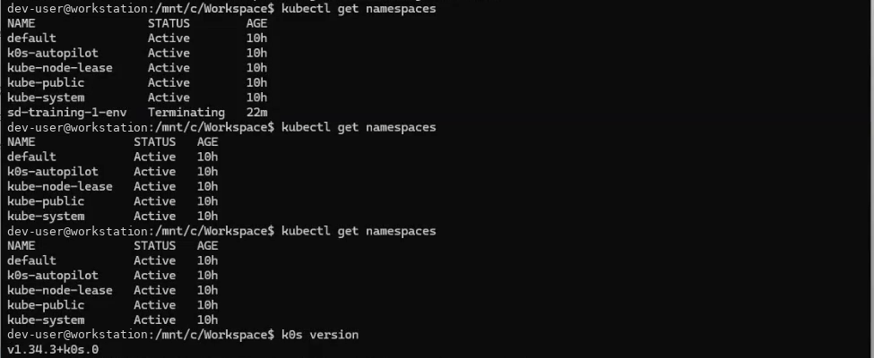

The [Kubernetes target preconditions](https://portal.criticalmanufacturing.com/Help/devops-center/deployment-targets/kubernetes-section/kubernetes-targets/kubernetes_on_premises/#preconditions) (Customer Portal, login required) list what the Manual target expects: PowerShell 7, a Kubernetes cluster ("either local, hybrid or on the cloud"), access to the Customer Portal, its Security Portal, the Critical Manufacturing container registry, Docker Hub and the Microsoft Container Registry, a load balancer such as MetalLB, `kubectl` configured and authenticated, a customer-managed ingress controller (agent 12.0.0 and later provide none), and the Traefik CRDs. Cluster admin is not required, only a role with access to a set of resource types. I used a cluster admin account on a laptop cluster, which is convenient and not necessary.

Check the nodes and the system pods:

```bash
kubectl get nodes
kubectl get pods -A
```

If the system pods are not running, nothing after this works, and you will blame the wrong layer. If you want a UI, the [Kubernetes Dashboard documentation](https://kubernetes.io/docs/tasks/access-application-cluster/web-ui-dashboard/) states that the Dashboard is deprecated and recommends Headlamp for new installations.

### Trap 1: No Storage Class the Volumes Can Use

**Symptom:** the environment YAML applies without an error, and the environment never comes up. The services that need volumes are the ones waiting.

**Reason:** the environment needs volumes, for data, logs and shared files, and some of them are ReadWriteMany. The [system requirements](https://help.criticalmanufacturing.com/12.0/systemrequirements/application-layer/applicationlayercontainers/#persistent-storage) list the supported volume types (Local, SMB/CIFS, NFS, Azure File, Storage Class and Persistent Volume) and say some volumes require the Read-Write-Many access mode. The 12.0 table has `installation-data` and `connect-iot-repo` as RWX, and it recommends high-performance block storage, at least 10000 IOPS, for some technologies. The 11.2.3 setup created these claims: `installation-data`, `redis-data`, `mssqlserver-data`, `grafana-share`, `connect-iot-repo`, `rabbit-data`, `rabbit-log`, `storage-data`, `kafka-data`, `clickhouse-data`, `clickhouse-log`, `mes-host-documents` and `mes-logs-share`. The list differs by version, so read it from your own generated YAML or the documentation for your version.

The volumes are requested through persistent volume claims, and a claim needs a storage class to be provisioned dynamically. Managed clusters usually ship one, and that cluster did not. The [Kubernetes documentation](https://kubernetes.io/docs/concepts/storage/storage-classes/) says a claim with no `storageClassName` is created as written, with no class set until a default appears, and the [persistent volumes page](https://kubernetes.io/docs/concepts/storage/persistent-volumes/) says that claims stay unbound until a matching volume exists.

The apply succeeds because it only creates the claims, and they stay unbound until a volume is provisioned. Three commands show it:

```bash
kubectl get storageclass
kubectl get pvc -A
kubectl describe pod <pod> -n <environment-namespace>
```

Look for no storage class, claims in `Pending`, and pod events that mention unbound claims.

**Fix:** give the environment a storage class that can serve its volumes, and select it in the Volumes step of the environment wizard. Any class used for the RWX volumes must support ReadWriteMany. That setup did not make its class the default (`storageClass.defaultClass=false`). It created a named class, `nfs-client`, on an NFS export inside WSL, and pointed the Volumes step at it.

The commands that setup used, taken from its install guide and not re-run by me, start with an NFS server in WSL and a folder to export. The export configuration itself was not legible, so I do not show it:

```bash
sudo apt-get update
sudo apt-get install -y nfs-kernel-server nfs-common
```

Then Helm, and the NFS subdir external provisioner chart, installed into its own namespace:

```bash
curl https://raw.githubusercontent.com/helm/helm/main/scripts/get-helm-3 | bash
helm version
helm repo add nfs-subdir-external-provisioner https://kubernetes-sigs.github.io/nfs-subdir-external-provisioner/
helm repo update
kubectl create namespace nfs-provisioner
helm install nfs-subdir-external-provisioner nfs-subdir-external-provisioner/nfs-subdir-external-provisioner \
  --namespace nfs-provisioner \
  --set nfs.server=localhost \
  --set nfs.path=/srv/nfs/k8s \
  --set storageClass.name=nfs-client \
  --set storageClass.defaultClass=false \
  --set storageClass.accessModes=ReadWriteMany
kubectl wait --for=condition=available --timeout=300s deployment/nfs-subdir-external-provisioner -n nfs-provisioner
```

The NFS server worked inside WSL 2 on Ubuntu 22.04 in that setup. I did not test other WSL kernels. A provisioner pod then binds the claims dynamically, and its log shows each claim of the environment provisioned with class `nfs-client`:

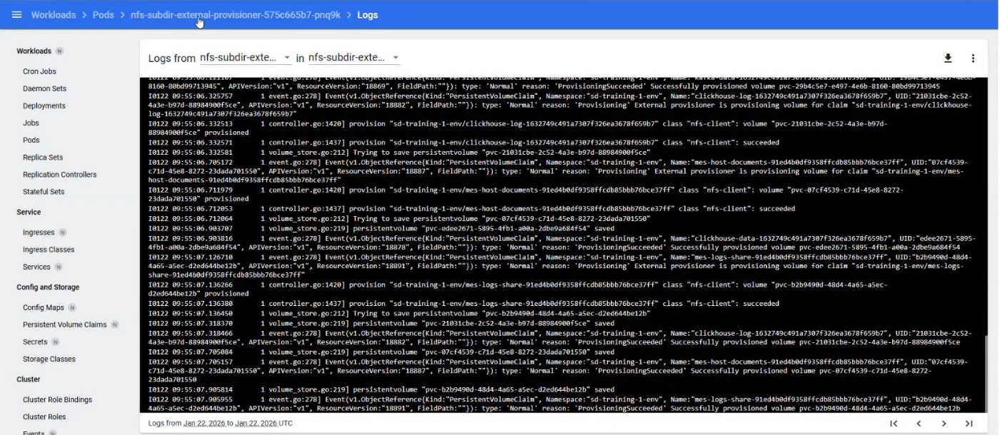

Kubernetes has no built-in NFS provisioner, and the storage classes page says an external one can be used. I did not check whether the Rancher local-path-provisioner supports ReadWriteMany for its default node-local storage, so I do not recommend it for the RWX volumes.

As a side note on defaults: per the Kubernetes documentation, if a default class appears later, existing claims with an unset `storageClassName` are updated to use it. If the environment sets a class name explicitly, as the Volumes step does, a default will not help, and you need a class with that name. That is another reason the storage class goes in before the environment, not after.

Because the volume claims reference a storage class, the reclaim policy of the class you create decides what happens to the data when volumes are removed. The [volume considerations in the 11.0 deployment guide](https://developer.criticalmanufacturing.com/12.0/explore/guides/migration/version-specific/1100/customer_deployment_1100/) say that a deployment referencing a storage class creates a claim with the same reclaim policy as the class, and that dynamic volumes may be lost or inaccessible if deleted. NFS volumes can be recreated pointing at the same location.

### Trap 2: Traefik CRDs Missing or the Wrong Version

This is the one I would check first, on any cluster. It is a common cause of "application not available" after an install or an upgrade, and it is the one that gives no obvious error.

**Symptom:** the install finishes, the pods run, and the URL says the application is not available. The UI and the Environment Manager are both unreachable. Nothing in the portal tells you why.

**Reason:** the environment's ingress routes are Traefik custom resources, consumed by the Traefik that runs inside the MES stack. If the Traefik CRDs are missing, or older than the version that MES stack's Traefik expects, Traefik cannot understand the routes that DevOps Center ships. There is no route, so there is nothing to open. The evidence is in the environment deploy output: the routes are applied as `ingressroute.traefik.io` and `middleware.traefik.io` objects, which only exist when the CRDs are installed.

The CRD version follows the **MES version**, not the agent. The mapping is in [Which Traefik Version the CRDs Must Match](#which-traefik-version-the-crds-must-match) below: for MES 11.2.3 and later 11.x it is 3.6, which is the version in this setup, for 11.2.0 to 11.2.2 it is 3.5, and for 12.0.0 and later it is 3.7. Two Traefik versions were in play in that setup: the agent ran its own Traefik image, 3.5.2, while the CRDs for MES 11.2.3 are v3.6.

To confirm the symptom, list the resources and read the Traefik logs once the environment is running:

```bash
kubectl get crd | grep traefik
kubectl get ingressroute -A
kubectl -n <environment-namespace> logs deployment/<traefik-deployment>
```

If the CRDs are missing, `kubectl` should not know the `ingressroute` resource type at all. If they are present but too old, look in the Traefik log for errors from its Kubernetes provider. I did not capture a failing case, so those are expectations, not captured output.

**Fix:** install the CRDs before you deploy the agent, which avoids a restart. In that setup the agent pods came up first, then the CRDs, then a restart of the agent's Traefik, all before the environment was created. The order I would use is the checklist order. The [Traefik documentation](https://doc.traefik.io/traefik/reference/install-configuration/providers/kubernetes/kubernetes-crd/) says to apply the definitions from the Traefik repository, with the version in the URL, and the target prerequisites link the CRD file for each version. Pick the row for your MES version. The version is part of the URL, so the pattern is the same for every row. The example is v3.6, for 11.2.3.

```bash
kubectl apply -f https://raw.githubusercontent.com/traefik/traefik/v3.6/docs/content/reference/dynamic-configuration/kubernetes-crd-definition-v1.yml
```

If the agent is already running, restart its Traefik so it picks the definitions up. That is what that setup did:

```bash
kubectl -n <agent-namespace> rollout restart deploy/traefik
```

Restart only that deployment. Restarting every deployment in the agent namespace restarts the Edge Forward Proxy too, and the agent goes red again until it reconnects.

The stack's Traefik RBAC is generated during deployment, per the [Kubernetes target preconditions](https://portal.criticalmanufacturing.com/Help/devops-center/deployment-targets/kubernetes-section/kubernetes-targets/kubernetes_on_premises/#preconditions) (Customer Portal, login required), so you do not add it by hand. That is separate from the RBAC of a customer-managed ingress controller on 12.x, which is yours to configure.

> If your cluster ingress controller is itself Traefik (the 12.x path), the [MES stack Traefik page](https://help.criticalmanufacturing.com/operationguide/system-administration/container-stack/messtackcomponents/#traefik) requires an entrypoint named `web-secure`, for example `--entrypoints.web-secure.address=:8443`. The MES stack references it, and a missing or renamed entrypoint makes HTTPS fail with no clear error.

## Step 4: Deploy the Agent

Extract the agent ZIP, open a PowerShell 7 terminal in that directory and run the deploy script. PowerShell 7 is a documented precondition of the Manual target, so install `pwsh` in WSL first. This is the documented path for the pre-12 agent, per the [pre-12 agent deployment page](https://portal.criticalmanufacturing.com/Help/devops-center/infrastructure-agent/create_infrastructure_agent_kubernetes_pre_12/#4-deploy) (Customer Portal, login required).

```bash
pwsh ./deployStackToKubernetes.ps1
```

The generated script calls `kubectl`, and k0s ships it as `k0s kubectl`. In that setup each `kubectl` line of the script was prefixed with `sudo k0s` before running it, so the lines look like `sudo k0s kubectl apply --server-side --field-manager=devopscenter.criticalmanufacturing --force-conflicts -f <file>.yaml`. The script then ran with `pwsh ./deployStackToKubernetes.ps1` from the extracted folder.

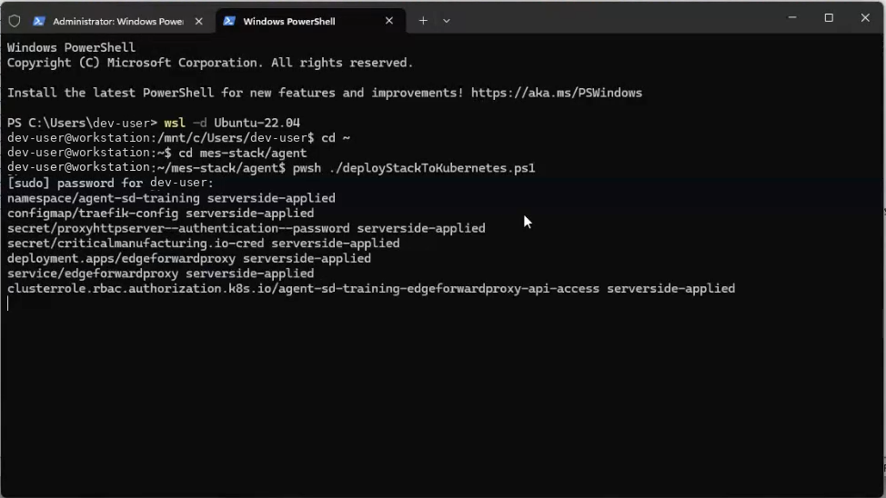

The script creates the agent namespace, the `traefik-config` config map, the secrets, the `edgeforwardproxy` deployment and service, the `edgesquidproxy` and `traefik` deployments, and the RBAC.

The result is three pods in the agent namespace: the Edge Forward Proxy, the Edge Squid Proxy and Traefik. A 12.0 agent has no Traefik pod, and Squid is optional and off by default, so expect one pod on a modern 12.x agent. In that setup the agent was 11.2.0, and the pods ran Traefik 3.5.2, edge-forward-proxy 11.2.0 and edge-squid-proxy 11.2.0. Check them:

```bash
kubectl -n <agent-namespace> get pods
```

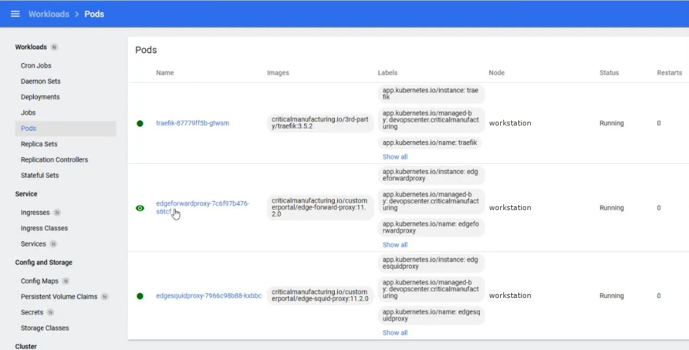

## Step 5: Agent Connected

The agent shows **red** in DevOps Center when it is not connected and **green** when it is. It started red. A few minutes later, when the `edgeforwardproxy` pod was ready, it turned green. Refresh the Customer Infrastructure page once that pod is ready.

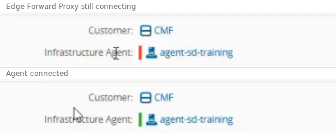

Red is a retry loop, not a failure. The proxy log shows it connecting its web socket and, on the first attempt, `WebSocket connection failed, retrying in 10 seconds`. It then connects and the indicator turns green. Read the log in the Kubernetes Dashboard or from the command line:

```bash
kubectl -n <agent-namespace> logs deploy/edgeforwardproxy
```

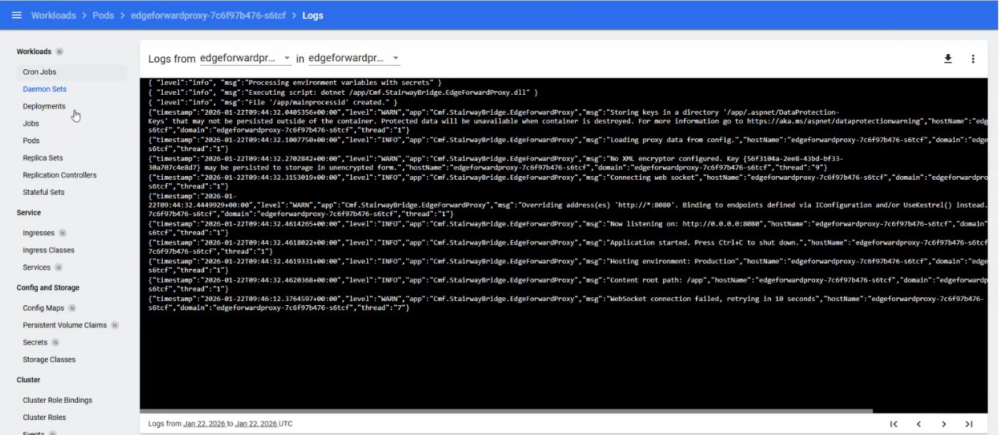

That pod can take a few minutes to start, and red only means the agent is not connected yet, so look at the pod before you delete anything. If it stays red, check that pod first, and check that the cluster reaches the addresses listed in the preconditions: the Customer Portal, its Security Portal, the Critical Manufacturing container registry, Docker Hub and the Microsoft Container Registry. The agent connects outbound, so it needs no inbound port.

Do not move to step 6 until it is green.

## Step 6: Create the Environment

Create the customer environment in DevOps Center with deployment target Kubernetes Manual. General Data holds the system name, the tenant name, the **public URL** (Application Public HTTP Address), whether TLS is enabled, the Installation Data Path and the deployment mode. In that setup the URL is a `.local` name, and here I use the placeholder `mes.local`. It becomes the entry point that Traefik uses as the main URL, and it matters again in the fourth trap. The installation data path was `/srv/nfs/k8s`, the NFS export from the first trap, and the deployment mode was Transactional.

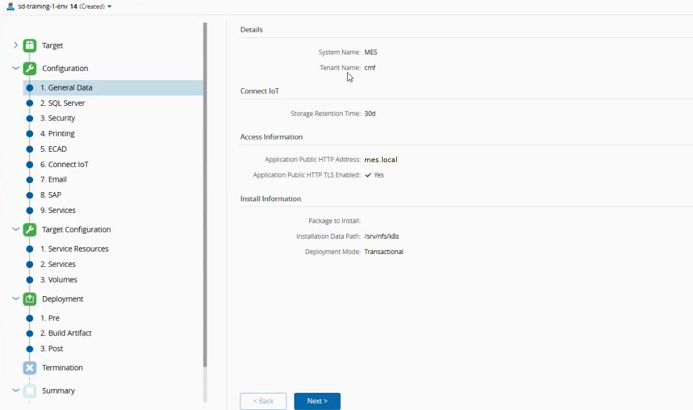

The Target Configuration group has a **Volumes** step. That is where that setup set the storage class to `nfs-client`, the class created in the first trap. Then download the environment ZIP.

## Step 7: Deploy MES

With the storage class selected in the Volumes step, download the environment deployment package into a folder that WSL can see and extract it. The setup also created a secret for the SQL connection user in the environment namespace before deploying. I did not capture the exact command. Run the deploy script from the extracted folder. It contains the deploy and remove PowerShell 7 scripts `deployStackToKubernetes.ps1` and `removeStackFromKubernetes.ps1`, per the [Manual Kubernetes deployment page](https://portal.criticalmanufacturing.com/Help/devops-center/deployment-targets/kubernetes-section/kubernetes-targets/kubernetes_on_premises/#deployment) (Customer Portal, login required).

```bash
pwsh ./deployStackToKubernetes.ps1
```

As with the agent, each `kubectl` line of the script was prefixed with `sudo k0s` in that setup. The script creates a namespace for the environment (reused on upgrades), then the secrets and config maps, then the remaining resources: deployments, services, volumes and ingresses. It prints the claims it applies:

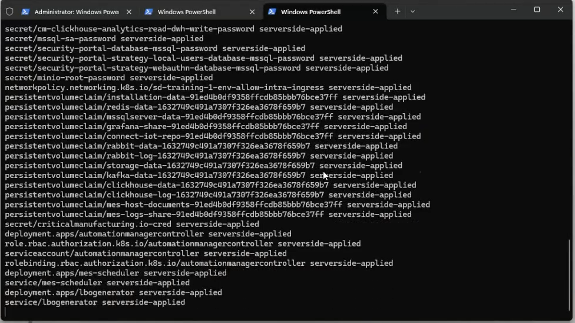

Watch until everything is Ready:

```bash
kubectl get deployments --watch -n <environment-namespace>
kubectl get pods --watch -n <environment-namespace>
```

This was a clean installation: no database and no packages. The Environment Manager fetches the product baseline database and the packages for the MES version, 11.2.3 in that setup, which needs the same network access as the agent. It restores the baseline and installs. It takes some minutes. On 11.x the agent's Edge Squid Proxy is one way to get there; from 12.0 the Edge Forward Proxy reaches the portal directly and Squid is not needed, per the [Edge Squid Proxy section](https://portal.criticalmanufacturing.com/Help/devops-center/infrastructure-agent/#edge-squid-proxy) (Customer Portal, login required).

Watch the provisioner create volumes as the claims bind, which shows the first trap is behind you. When the pods run, the last two traps are left.

### Trap 3: The LoadBalancer Stuck on Pending

**Symptom:** the pods are running and the environment is deployed. `kubectl get services` shows the Traefik service with `EXTERNAL-IP` as `<pending>`, and it stays that way.

**Reason:** a service of type `LoadBalancer` needs something to provide the load balancer. The [Kubernetes documentation](https://kubernetes.io/docs/concepts/services-networking/service/) says that Kubernetes does not offer a load balancing component directly: you provide one, or integrate the cluster with a cloud provider. Managed clusters do the second. A bare cluster does neither.

```bash
kubectl get services -A
```

In that setup the `traefik-lb` service in the agent namespace was a `LoadBalancer` with `EXTERNAL-IP` `<pending>`, mapping ports 80 and 443 to node ports:

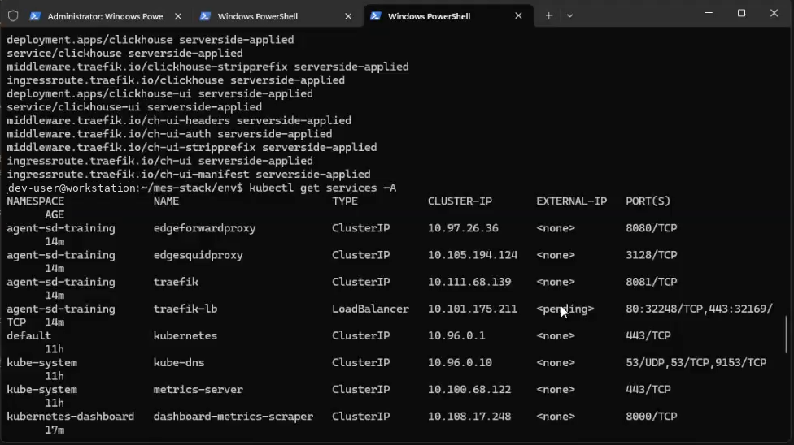

**Fix:** install a bare-metal implementation. The Manual target lists a load balancer such as MetalLB as a precondition. That setup used [MetalLB](https://metallb.io/installation/). The steps are install it, wait for its pods, create an address pool, create a layer 2 advertisement and give the Traefik service an address from the pool. That setup installed MetalLB v0.14.8. The installation page I read lists a newer release, v0.16.2, and an FRR-K8s manifest as the recommended mode. The native manifest is the simplest, and I have not compared the two.

```bash
kubectl apply -f https://raw.githubusercontent.com/metallb/metallb/v0.14.8/config/manifests/metallb-native.yaml
kubectl -n metallb-system get pods
```

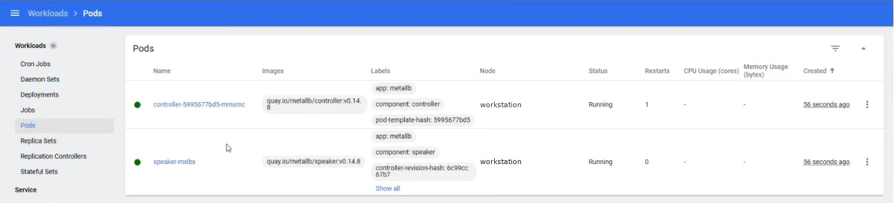

The installation does not include a configuration, so nothing is assigned until you add one. The [configuration page](https://metallb.io/configuration/) shows both resources. That setup named the pool `wsl-pool`, because the range comes from the WSL network, and the range is specific to that network. The next subsection explains how to choose yours:

```yaml
apiVersion: metallb.io/v1beta1
kind: IPAddressPool
metadata:
  name: wsl-pool
  namespace: metallb-system
spec:
  addresses:
  - 172.31.133.240-172.31.133.250
---
apiVersion: metallb.io/v1beta1
kind: L2Advertisement
metadata:
  name: wsl-adv
  namespace: metallb-system
```

An `L2Advertisement` without a pool selector applies to every pool. An early `connection refused` when applying these means the MetalLB webhook was not ready yet, so wait a minute and retry.

Then that setup ran a patch on the Traefik service:

```bash
kubectl -n <agent-namespace> patch svc traefik-lb -p '{"spec":{"type":"LoadBalancer"}}'
```

The output was `patched (no change)`: the service was already a `LoadBalancer`, and the address came from the pool. The service then showed `EXTERNAL-IP` `172.31.133.241`, inside the pool:

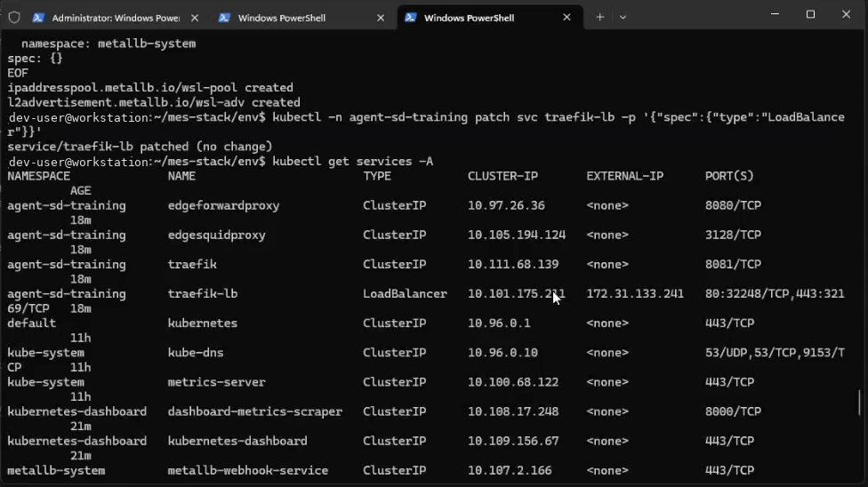

To pin the service to a known address instead, the [MetalLB usage page](https://metallb.io/usage/) documents an annotation. This is an optional alternative, not what that setup did:

```bash
kubectl -n <agent-namespace> annotate service traefik-lb metallb.io/loadBalancerIPs=172.31.133.241
```

The service is owned by the agent YAML, so applying that YAML again can revert a hand-made annotation. A pool with a single address achieves the same result and survives a re-apply.

#### Choosing the Pool in WSL

MetalLB in layer 2 mode answers ARP requests on the local network, so the pool must come from a subnet that Windows can reach. By default, [WSL uses NAT](https://learn.microsoft.com/windows/wsl/networking): the VM has its own virtual adapter and its own IP, which you read from Windows with `wsl hostname -I`. Mirrored networking mode needs Windows 11 22H2 or later.

To pick addresses, look at the subnet inside WSL and choose a few unused ones in it:

```bash
ip -4 addr show eth0
ping -c 1 <candidate-address>
```

The first command shows the VM address and prefix length, and the pool goes in that subnet, away from the VM's own address. In that setup the pool was a range of the WSL network, and a range outside the VM's own subnet would not be announced usefully. A candidate that does not answer the ping is probably free. The setup's WSL networking mode was not shown. In NAT mode, the VM address can change after a restart, in my understanding, and that breaks both a fixed pool and the hosts file entry from the next trap. Check `wsl hostname -I` after a restart. I did not test the pool choice on every networking mode.

### Trap 4: The Name Windows Cannot Resolve

**Symptom:** the service has an external IP and the browser still says the site cannot be reached, with `DNS_PROBE_FINISHED_NXDOMAIN`.

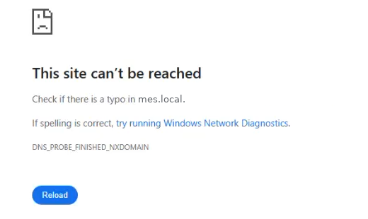

**Reason:** the environment answers on the public URL you typed in step 6, `mes.local` in this post. Nothing resolves that name to the Traefik IP.

**Fix:** add an entry to the Windows hosts file, `C:\Windows\System32\drivers\etc\hosts`, that maps the external IP of the Traefik service to the public URL. Open it in an elevated editor. The browser runs on Windows, so the entry goes in the Windows file, not the one inside WSL.

```text
172.31.133.241   mes.local
```

The address is the one from trap 3 and the name is a placeholder. Use the IP of your service and the exact URL you configured in the environment. Reachability from Windows to a MetalLB address in the WSL network worked in that setup, and the networking mode was not shown, so keep the caution above.

After that the browser reaches the stack and shows "Your connection is not private", `NET::ERR_CERT_AUTHORITY_INVALID`, because the certificate is not trusted. On a local setup you can proceed past the warning. Do not do that in production: install a trusted certificate instead. The `.local` suffix is reserved for multicast DNS, so a suffix such as `.test` is the safer placeholder.

## Step 8: Validate

List the namespaces and the pods, then open the URL:

```bash
kubectl get namespaces
kubectl get pods --watch -n <environment-namespace>
```

Open the public URL you configured, `mes.local` in this post. The first login prompts for a new password for the initial user, as usual. Then MES opens:

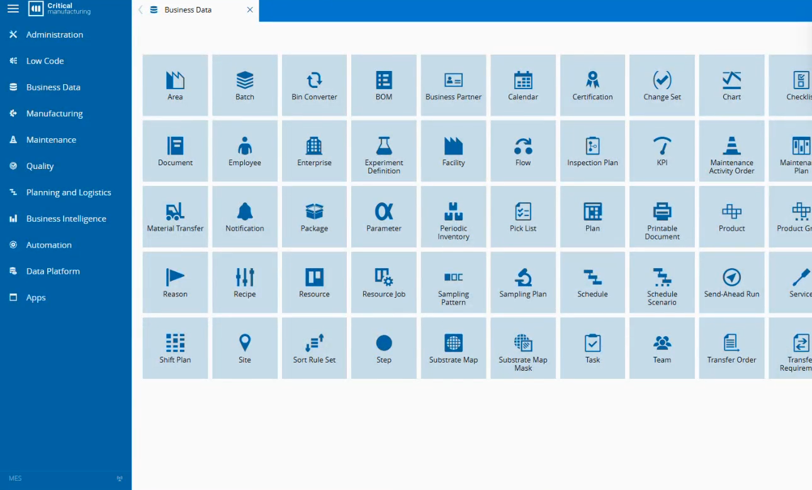

## Which Traefik Version the CRDs Must Match

The CRDs match the Traefik of the **MES stack**, chosen by MES version, not the Traefik of the agent. The [Kubernetes target preconditions](https://portal.criticalmanufacturing.com/Help/devops-center/deployment-targets/kubernetes-section/kubernetes-targets/kubernetes_on_premises/#preconditions) (Customer Portal, login required) say the installed version must match the Traefik version, which varies with the MES version, and publish this mapping:

| MES version | Traefik version |
| :-- | :-- |
| ^9 | 2.6.2 |
| ^10 | 2.10.3 |
| >=10.2.14 | 2.11.31 |
| ~11.0.0 | 3.0 |
| >=11.1.0 & <=11.1.5 | 3.1 |
| ~11.1.6 | 3.4 |
| >=11.2.0 & <=11.2.2 | 3.5 |
| >=11.2.3 & <12.0.0 | 3.6 |
| >=12.0.0 | 3.7 |

The [Ingress Controller Requirements](https://portal.criticalmanufacturing.com/Help/devops-center/deployment-targets/kubernetes-section/ingress-controller/) page (Customer Portal, login required) adds that these CRDs are used by the MES stack's Traefik, even when the cluster ingress controller is a different product. So you need them whether or not you run the agent's Traefik.

The setup shows why this matters. The agent was 11.2.0 and ran its own Traefik image, 3.5.2, while the environment was MES 11.2.3, whose CRDs are v3.6 per the mapping. The agent's Traefik version did not select the CRDs. The MES version did.

That settles the case of a customer who does not want the agent's Traefik, for security reasons or because they already run an ingress. They route to the Traefik inside the MES stack, and the CRDs follow the MES version. In 12.0.0 the "Connect to a central Traefik" option, which registered the stack on the agent's Traefik, is removed altogether. The [Traefik v2 to v3 migration details](https://doc.traefik.io/traefik/migrate/v2-to-v3-details/) also state that the `traefik.containo.us` CRD API group was removed in v3 in favor of `traefik.io`, which is why the v2 and v3 rows are not interchangeable.

## Tearing It Down

For a Manual target, terminate the version in DevOps Center and run `removeStackFromKubernetes.ps1` from the artifact. Per the [terminate section](https://portal.criticalmanufacturing.com/Help/devops-center/deployment-targets/kubernetes-section/kubernetes-targets/kubernetes_on_premises/#terminate) (Customer Portal, login required), it deletes the namespace and the non-namespaced resources related to it, and it does not remove volumes unless you pass `-RemoveVolumes`. The options and the reasons to tick or skip them are in the [Remove section of the first post](https://j-roque.com/posts/20261119-devops-center-install/#remove).

## What I Did Not Verify

- The output of a `Pending` claim without a storage class and of a missing-CRD failure. I describe what I expect there, not captured output.
- Whether the local-path-provisioner supports ReadWriteMany for its default storage. I did not check it. That setup used NFS.
- The exact command that created the SQL connection user secret, and the NFS export configuration.
- That the WSL VM address changes after a restart, and that the pool choice works on every networking mode.
- That a hand-made annotation on the Traefik service is reverted when the agent YAML is applied again.
- That `.local` causes trouble here. It is reserved for multicast DNS, but I did not test it.
- MetalLB's native mode against its recommended FRR-K8s mode, and the pinned release.

## Final Thoughts

A bare cluster leaves two jobs that a managed one does for you, a storage class that can serve the environment's volumes and a LoadBalancer implementation. Two more are yours on any cluster: the Traefik CRDs that match the Traefik of your MES version, and a name Windows can resolve. From agent 12.0.0 an ingress controller joins that list.

If the environment on a local cluster does not open, check the storage class, the Traefik CRDs, the load balancer and the name resolution, in that order.
